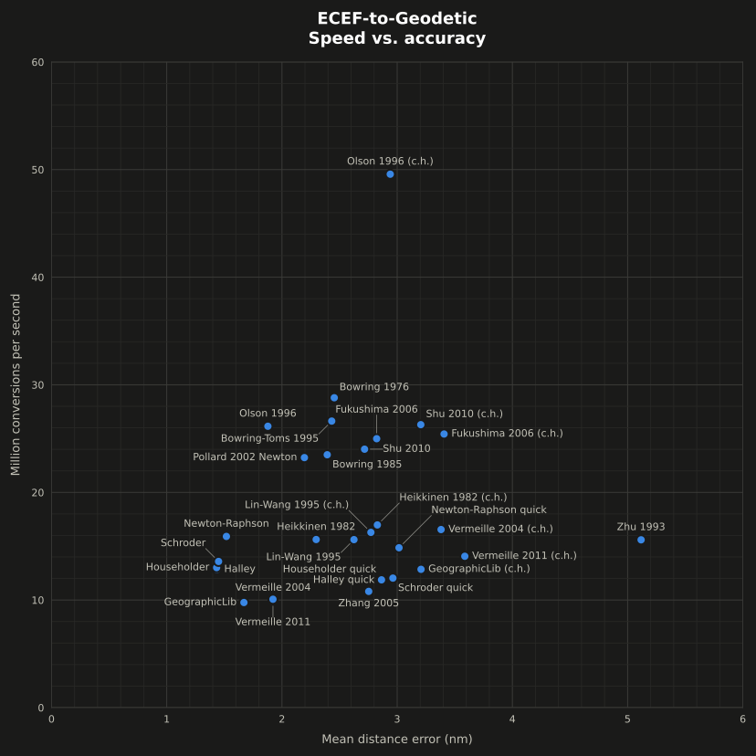

# ecef-geodetic

A test suite that measures the accuracy and speed of about 80 ECEF-to-geodetic conversion functions on the WGS 84 ellipsoid.

## Usage

Generate the input data files, which are text files of ECEF and geodetic coordinates.

```sh
make -j $(nproc) input
```

Build the accuracy and speed tests.

```sh
make -j $(nproc)
```

Run the accuracy and speed tests.

```sh
make full
```

* Takes about 1 minute to finish
* Runs the two tests one after the other, even under `make -j`

The accuracy and speed tests write JSON files into a folder within `results` that is named for
the UTC time the run started.
`make full` then combines them into a CSV file and a filtered CSV file in that same folder, and
plots the filtered one into an SVG file there.

See [Makefile](Makefile) for all possible targets.

## Requirements

### C++ libraries

- [Google Benchmark](https://github.com/google/benchmark)
- [nlohmann-json](https://github.com/nlohmann/json)
- [oneTBB](https://github.com/oneapi-src/oneTBB)

### Python modules

- [matplotlib](https://matplotlib.org/)
- [numpy](https://numpy.org/)

### Programs

See [Makefile](Makefile) for detailed list of programs that are required to run.  The build needs g++ 14 or later, for `-std=c++26` and `<print>`.  `make full` needs GNU Make 4.4 or later, for `.WAIT`.

## Results

Only algorithms with a mean distance error less than 10nm were included in the figure below.  Each iterative algorithm in the figure did 2 iterations.  "(c.h.)" means the algorithm used a "custom height" formula to calculate ellipsoid height instead of the standard formula.


*Scatter plot of ***accuracy***, measured by mean distance error (nm), versus ***speed***, measured in millions of conversions per second*

Results closer to the upper-left corner of the figure are better.
